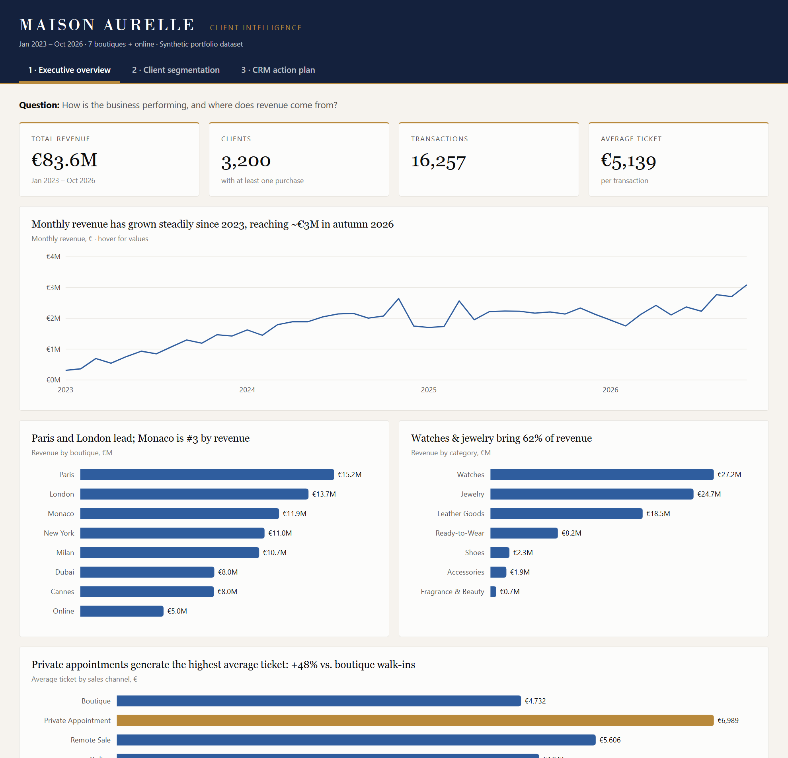
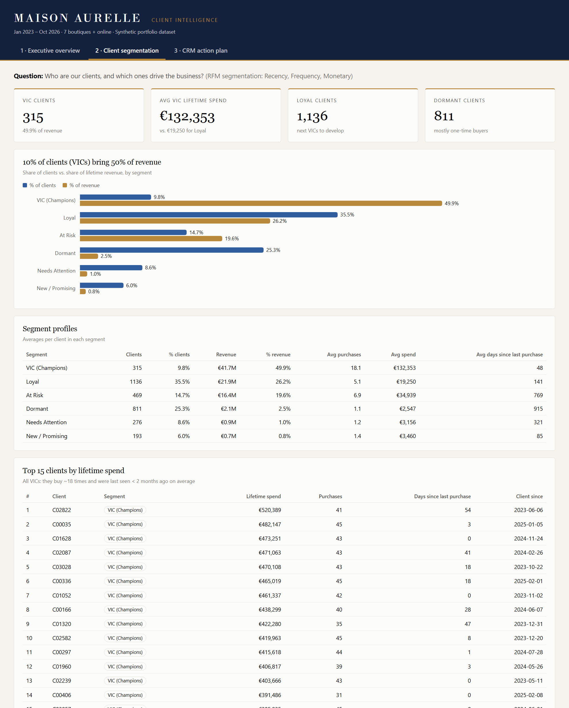
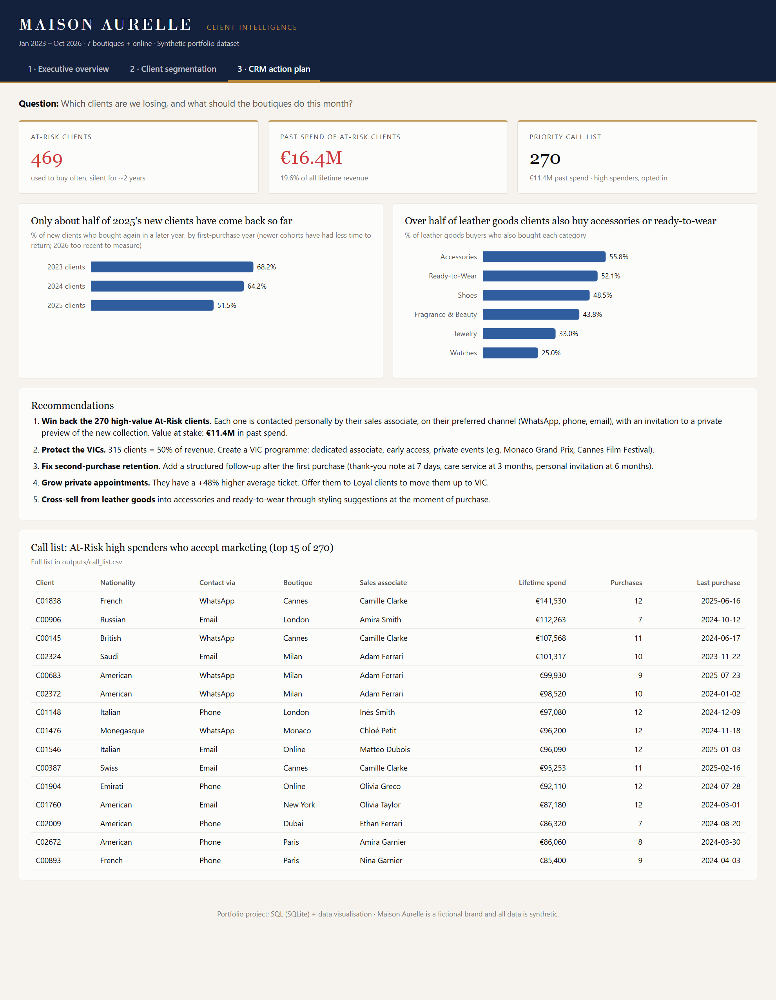

  

  <i>Who are our most valuable clients, and who are we about to lose?</i> 
  A client intelligence study for a luxury maison · SQL · Power BI · RFM segmentation

  <a href="Maison_Aurelle_Case_Study.pdf"><b>Read the 2-page case study (PDF)</b></a> &nbsp;·&nbsp;
  <a href="#the-dashboard"><b>See the dashboard</b></a> &nbsp;·&nbsp;
  <a href="queries.sql"><b>Explore the SQL</b></a>

---

## At a glance

| | |
|---|---|
| **10% → 50%** | VIC clients generate half of all revenue |
| **€16.4M** | past spend of 469 At-Risk clients, silent for ~2 years |
| **270 clients** | priority win-back list (€11.4M past spend), matched to their sales associate |
| **+48%** | higher average ticket for private appointments vs. boutique walk-ins |

> **Maison Aurelle is a fictional luxury maison.** Real client data in luxury is
> confidential, so this dataset is synthetic, built to reflect realistic luxury
> retail patterns: 7 boutiques + online (Monaco, Paris, Cannes, Milan, London, Dubai,
> New York), 3,200 clients and 16,257 transactions from January 2023 to October 2026.

---

## The business challenge

In luxury, a small circle of clients carries the business, and every lost relationship
is costly. The CRM team of Maison Aurelle asked three questions:

1. **How is the business performing**, and where does revenue come from?
2. **Who are our most valuable clients**, and how concentrated is revenue?
3. **Which clients are we losing**, and **who should sales associates contact first?**

## Approach

| Step | What was done | Tools |
|---|---|---|
| 1 · Business KPIs | Revenue, clients and average ticket by boutique, category, channel and nationality | SQL |
| 2 · RFM segmentation | Each client scored 1–5 on **R**ecency, **F**requency and **M**onetary value, then grouped into six segments | SQL (window functions) |
| 3 · Retention & cross-selling | Cohort return rates; categories bought by leather goods clients | SQL |
| 4 · Action list | At-Risk high spenders who accept marketing, with sales associate and preferred channel | SQL |
| 5 · Dashboard | Three pages: Executive overview → Client segmentation → CRM action plan | Power BI |

## Client segmentation

| Segment | Clients | % of clients | % of revenue | Avg lifetime spend | Profile |
|---|--:|--:|--:|--:|---|
| **VIC (Champions)** | 315 | 9.8% | **49.9%** | €132,353 | Buy often, spend most, seen recently |
| Loyal | 1,136 | 35.5% | 26.2% | €19,250 | Regular clients, the next VICs |
| **At Risk** | 469 | 14.7% | **19.6%** | €34,939 | Valuable, but silent for ~2 years |
| Dormant | 811 | 25.3% | 2.5% | €2,547 | Mostly one-time buyers |
| Needs Attention | 276 | 8.6% | 1.0% | €3,156 | Low engagement |
| New / Promising | 193 | 6.0% | 0.8% | €3,460 | Recent first purchases |

## Key findings

- **Revenue is highly concentrated.** 315 VICs bring €41.7M, half of all revenue.
- **A silent risk.** 469 once-frequent clients have not purchased in ~2 years on average (€16.4M past spend). 270 of them are high spenders who accept marketing.
- **Leather goods open the door, watches & jewelry drive value.** Leather goods are 31% of purchases, while watches and jewelry make up 62% of revenue.
- **Private appointments pay off.** €6,989 average ticket vs. €4,732 for boutique walk-ins.
- **The second purchase is the weak point.** Only 51.5% of 2025's new clients have returned so far, vs. 68.2% for the 2023 cohort (newer cohorts have had less time to return).

## Recommendations

1. **Win back 270 high-value At-Risk clients.** Personal outreach by their own sales associate, on their preferred channel (WhatsApp, phone, email), with an invitation to a private preview of the new collection.
2. **Protect the VIC circle.** A dedicated associate, early access to collections and private experiences linked to the Riviera calendar (Monaco Grand Prix, Cannes Film Festival, Monaco Yacht Show).
3. **Design the second-purchase journey.** Thank-you note at 7 days, after-care service at 3 months, personal invitation at 6 months.
4. **Extend private appointments to Loyal clients** to lift their average ticket and move them towards VIC status.
5. **Cross-sell from leather goods** into accessories and ready-to-wear with styling suggestions at the moment of purchase.

## The dashboard

Every chart title states the insight, not just the metric.

**1 · Executive overview**

**2 · Client segmentation**

**3 · CRM action plan**

## Next steps with real data

- Validate the segments with boutique and CRM teams.
- Add customer lifetime value (CLV) and a churn prediction model.
- A/B test the win-back campaign and measure its return on investment.

## Repository

| File | Content |
|---|---|
| [`Maison_Aurelle_Case_Study.pdf`](Maison_Aurelle_Case_Study.pdf) | Two-page executive case study |
| [`queries.sql`](queries.sql) | All SQL queries, commented, from KPIs to RFM segmentation |
| [`maison_aurelle.db`](maison_aurelle.db) | SQLite database (opens with DB Browser for SQLite) |
| [`powerbi/Maison_Aurelle_Dashboard.pbix`](powerbi/Maison_Aurelle_Dashboard.pbix) | **Power BI dashboard**: data model, DAX measures, 3 report pages (open with Power BI Desktop) |
| [`powerbi/`](powerbi/) | Same report as a Power BI project in text format (`.pbip`), readable on GitHub |
| [`dashboard.html`](dashboard.html) | Interactive web version of the dashboard |
| [`data/`](data/) | Source tables: transactions, clients, products, boutiques, sales associates |
| [`outputs/`](outputs/) | Analysis results used in the dashboard |
| [`POWER_BI_GUIDE.md`](POWER_BI_GUIDE.md) | How the Power BI report is built: data model, DAX measures, pages |

---

Maison Aurelle is a fictional brand. All data is synthetic and was created for this portfolio project.

